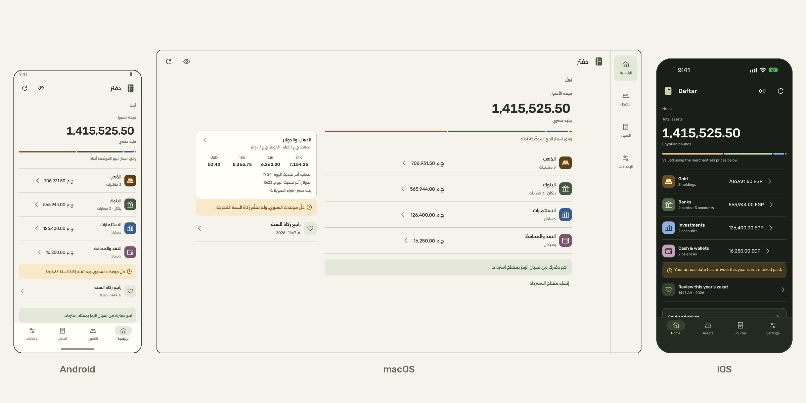
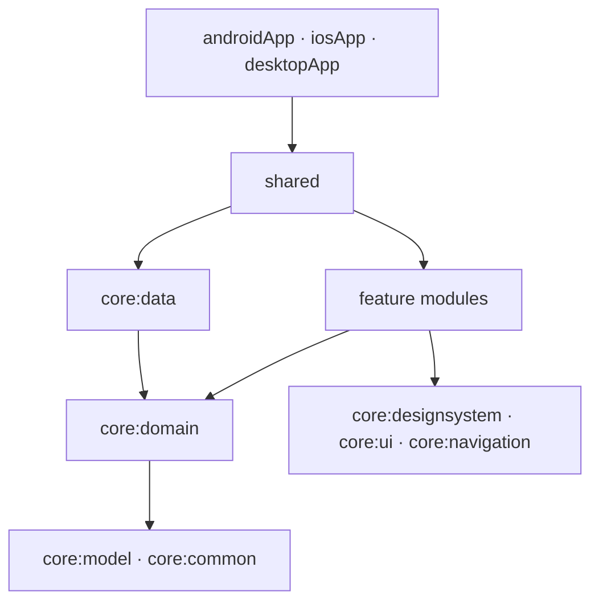

# Daftar · دفتر

**A private notebook for what you own.**

Gold, bank accounts, cash and investment values, together in Egyptian pounds. Daftar keeps your financial records in an encrypted local vault, opened with your own PIN and optional biometrics.

Built with Kotlin Multiplatform and Compose Multiplatform. Arabic comes first, with full English support. Local use requires no account.

[](https://github.com/mahmoudibrahimabdulfattah/Daftar/actions/workflows/ci.yml)
[](https://kotlinlang.org/multiplatform/)
[](https://github.com/JetBrains/compose-multiplatform)

<picture>
  <source media="(prefers-color-scheme: dark)" srcset="docs/media/readme/hero-dark.png">
  <source media="(prefers-color-scheme: light)" srcset="docs/media/readme/hero-light.png">
  
</picture>

Android, iOS and macOS. Arabic and English, light and dark. All screenshots and the demo use illustrative data.

## Watch Daftar

A short 1080p walkthrough across all three platforms, with English captions and Arabic subtitles. No audio.

VIDEO_URL

## What it does

- **Keep a record of your assets.** Track gold by karat and net weight, bank accounts and cash in EGP or USD, and investment accounts with an EGP value you update yourself.
- **See their value together.** Gold uses the goldsmith’s sell price for its karat. USD balances are converted for display; their recorded currency stays intact. Monetary calculations use exact decimals.
- **Know where prices came from.** Gold and exchange-rate quotes carry source and time information. Cached quotes remain available when refresh fails, and manual prices can fill gaps. A pinned manual override takes precedence until removed. Missing prices produce an incomplete valuation with an available subtotal.
- **Keep zakat records.** View a 2.5% planning estimate of the tracked total, organize years with the civil Hijri calendar, and record payments. Payment records do not deduct from assets.
- **Keep private notes.** Journal entries stay separate from portfolio calculations. The visibility control masks financial values on screen.
- **Take an encrypted copy.** Export and restore `.dftar` files. Optional Google cloud backups on Android and desktop provide three slots, with a 768 KiB limit per encrypted backup. Uploads are explicit; there is no automatic portfolio sync.

## Designed for each screen

Paper tones, olive accents and brass for gold give Daftar the quiet feel of a notebook. Alexandria carries Arabic text; Rubik handles English and numeric runs. Layout direction follows the language, while numbers and units stay readable.

| Android · Arabic · Light | iPhone · English · Dark |
| --- | --- |
|  |  |

Compact screens use bottom navigation. Desktop adds a navigation rail, bounded reading widths, keyboard input and side-by-side details where useful. Wide Home layouts place prices beside the portfolio overview.


The macOS image is an offscreen rendering of the app’s client area.

The [approved design](docs/design/daftar.html) and [desktop layout contract](docs/design/phase-28-desktop.md) document the visual decisions. `DesignCatalog` is the runnable component reference.

## Platform status

| Platform | Vault and unlock | Capture protection |
| --- | --- | --- |
| **Android 8.0+ · API 26+** | PIN and optional biometrics. Release requires a hardware-backed Keystore. | `FLAG_SECURE`; verified. |
| **iOS 16.0+ · iPhone and iPad** | PIN and optional Face ID or Touch ID, with Secure Enclave protection on devices. | Secure-canvas shield and capture-state fallback implemented. Real-iPhone verification is pending. |
| **macOS** | PIN and optional Touch ID. Release requires a supported Secure Enclave. | `NSWindowSharingNone`; verified. |
| **Windows x64** | Development builds are PIN-only. Release vault access refuses because TPM protection is not implemented. | `WDA_EXCLUDEFROMCAPTURE` implemented; verification remains outstanding. |

On iOS, [`CaptureShield.swift`](iosApp/iosApp/CaptureShield.swift) hosts the app inside a secure text field’s canvas. If that canvas is unavailable, a cover hides content during detected recording or mirroring; this fallback cannot prevent still screenshots. The implementation has been exercised only in the simulator so far. Simulator capture bypasses the shield, so it does not establish protection on a real iPhone.

Google cloud backups are available on configured Android and desktop builds. They are unavailable on iOS.

## Architecture worth exploring

Shared Compose screens sit above domain contracts. `shared` assembles the features, repositories, security services and platform adapters through Koin.



The diagram shows the main dependency direction. Features do not depend on one another or on `core:data`.

| Start here | What to explore |
| --- | --- |
| [`core/domain`](core/domain) | Pure valuation, quote selection, Hijri dates and zakat rules. Calculation functions receive time as input. |
| [`core/designsystem`](core/designsystem) | Custom theme, bundled fonts, stateless components and Compose Styles. |
| [`core/data`](core/data), [`core/database`](core/database), [`core/database-driver`](core/database-driver) | Repository implementations and Room over encrypted SQLite. Android and iOS use SQLCipher; desktop uses SQLite3 Multiple Ciphers in its SQLCipher v4 scheme through JNA. |
| [`core/security`](core/security) | PIN envelopes, persistent backoff, biometric key slots and platform protection. |
| [`core/backup`](core/backup) | Versioned, authenticated exports and restore contracts. |
| [`core/account`](core/account), [`core/cloud`](core/cloud) | Optional Google sign-in and encrypted backup storage. |
| [`shared`](shared) | App composition, navigation, the vault gate and lifecycle coordination. |
| [`build-logic`](build-logic) | Convention plugins for KMP libraries, Compose, features and the Android shell; shared compiler and formatting rules. |

## Security model

### The local vault

The database uses a **random 256-bit data-encryption key**, or DEK. Argon2id derives a wrapping key from the PIN; XChaCha20-Poly1305 wraps the DEK with that key. The resulting envelope is then sealed by the platform protector before storage.

Changing the PIN rewraps the existing DEK without re-encrypting the database. Wrong-PIN attempts trigger persistent backoff. See [`DefaultVaultSecurity.kt`](core/security/src/commonMain/kotlin/com/mk/daftar/core/security/DefaultVaultSecurity.kt).

Release vaults require hardware protection. Android and desktop development builds may allow software keys with a visible warning; the iOS simulator has a separate test-only protector with no hardware guarantee.

The app covers private content during lifecycle transitions and locks on backgrounding or foreground inactivity. Desktop also locks on minimize, hide and supported system-session events. Android system backup and device transfer are disabled; iOS vault files are excluded from backup and Keychain records are device-only.

### Backups and recovery

A `.dftar` export uses a separate password of at least 12 characters, Argon2id and XChaCha20-Poly1305. Fresh salts and nonces are generated for each export, and the header is authenticated.

The frozen version-one container remains readable and is written when no recovery key exists. With a recovery key enabled, version two encrypts the payload under a random backup key, wrapped for both the password and the recovery public key. The binary layout is documented in [`BackupFormat.kt`](core/backup/src/commonMain/kotlin/com/mk/daftar/core/backup/BackupFormat.kt).

An optional recovery key is shown once and is not stored by the app. Keep it somewhere safe:

- Resetting a forgotten PIN requires the recovery key **and the original device**.
- The key can open backups created with that key enabled. It cannot open older password-only backups.
- Google sign-in provides access to cloud backup files; decrypting them still requires the backup password or the matching recovery key.

Cloud storage receives the encrypted backup file. Configuration and Firestore rules are documented in [`docs/firebase`](docs/firebase).

## Verification

[CI](.github/workflows/ci.yml) runs Spotless, Android host tests, Android lint and the debug build. Release, desktop, iOS and device checks are part of the broader local verification required before a PR.

```bash
./gradlew spotlessCheck testAndroidHostTest :androidApp:lintDebug :androidApp:assembleDebug :androidApp:assembleRelease
./gradlew desktopTest :desktopApp:compileKotlinJvm
./gradlew iosSimulatorArm64Test :shared:linkDebugFrameworkIosSimulatorArm64
xcodebuild -project iosApp/iosApp.xcodeproj -scheme iosApp \
  -destination 'platform=iOS Simulator,name=iPhone 18 Pro' -derivedDataPath build/xcode build
```

Security, Room and lifecycle changes also require Android device tests on an emulator or connected device:

```bash
./gradlew connectedAndroidDeviceTest :androidApp:connectedDebugAndroidTest
```

For UI changes, run the Android debug app and the iPhone 18 Pro simulator, then exercise the desktop app offscreen:

```bash
./gradlew :desktopApp:jvmTest
```

The desktop UI tests drive the real app with synthetic input and write screenshots to `desktopApp/build/screens`. iOS capture changes additionally require verification on a real iPhone.

## Run locally

Use **JDK 21**, **Android SDK platform 37** (`android-37.0`) and the included Gradle wrapper. iOS builds require macOS and Xcode; the configured simulator target is Apple Silicon. macOS native components also require Xcode’s command-line tools.

Run commands from the repository root. On Windows, use `gradlew.bat` in place of `./gradlew`.

### Android

Open the project in Android Studio and run `androidApp` on an emulator or device. To build the debug APK:

```bash
./gradlew :androidApp:assembleDebug
```

The debug application ID is `com.mk.daftar.debug`.

### iOS

Open `iosApp/iosApp.xcodeproj` in Xcode, select the `iosApp` scheme and run on **iPhone 18 Pro**. To build from the command line:

```bash
./gradlew :shared:linkDebugFrameworkIosSimulatorArm64
xcodebuild -project iosApp/iosApp.xcodeproj -scheme iosApp \
  -destination 'platform=iOS Simulator,name=iPhone 18 Pro' -derivedDataPath build/xcode build
```

### Desktop

```bash
./gradlew :desktopApp:run
```

This starts a debug build with its own **Daftar Debug** data directory. Desktop builds remain debug unless built with `-Pdaftar.desktop.release=true`; release requires supported hardware protection.

### Optional configuration

`androidApp/google-services.json` and `desktopApp/firebase-desktop.properties` are optional and git-ignored. Builds succeed without them, with cloud backups unavailable. Use the [Firebase setup guide](docs/firebase/README.md) and [desktop configuration example](desktopApp/firebase-desktop.properties.example) when enabling cloud backups.

Android release signing is also optional for compilation. Copy [`keystore.properties.example`](keystore.properties.example) to the git-ignored `keystore.properties` and reference a keystore outside the repository. Without signing configuration, `:androidApp:assembleRelease` produces an unsigned APK and never falls back to the debug key.

## Project status and contributing

Daftar is under active development. Windows hardware protection and real-iPhone capture verification remain open. The [roadmap](docs/roadmap.md) records the project phases and their acceptance criteria.

Follow [AGENTS.md](AGENTS.md), keep each phase to one branch and one PR, and include the relevant verification results. UI changes should follow the approved design and keep the component catalog current. Use illustrative data in tests, screenshots and reports.

Bundled font licenses and third-party notices are available in Settings → About.

LICENSE_LINE

If Daftar is useful to you, give the repository a star.

Mahmoud Ibrahim (GitHub [@mahmoudibrahimabdulfattah](https://github.com/mahmoudibrahimabdulfattah)).

