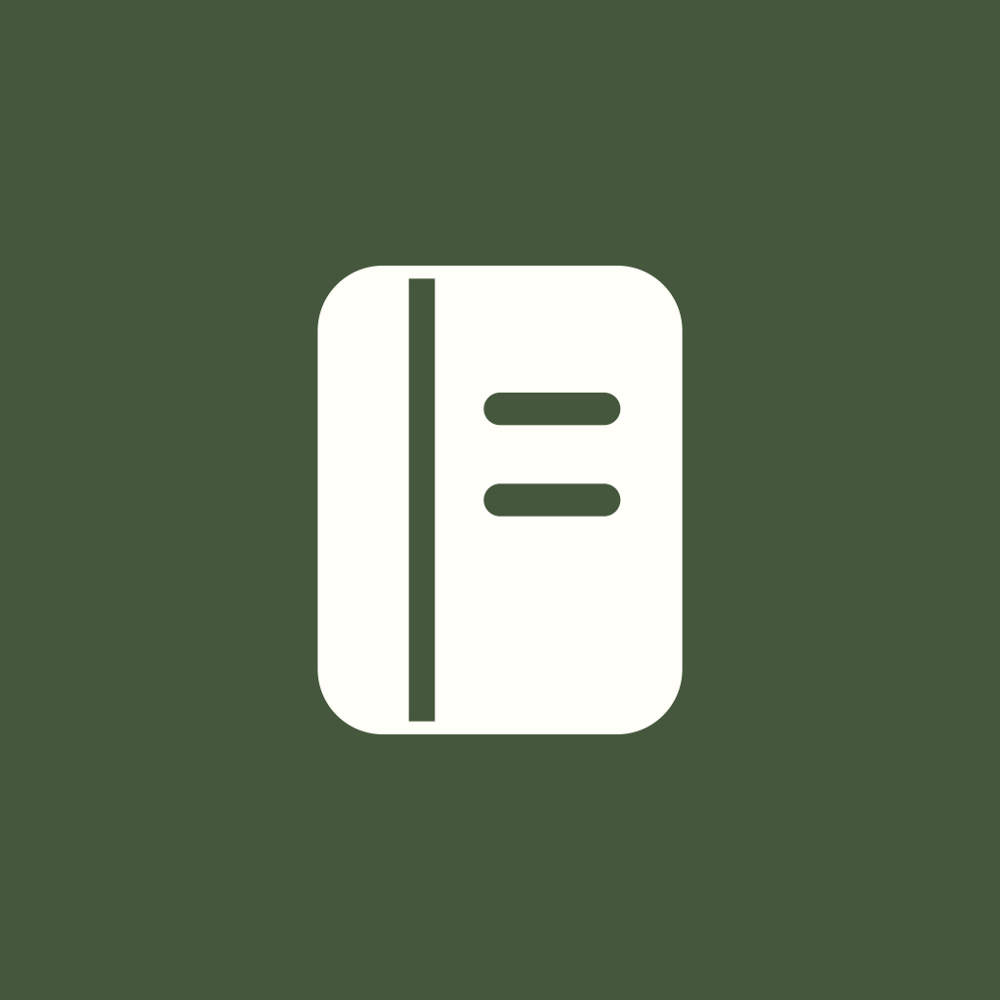
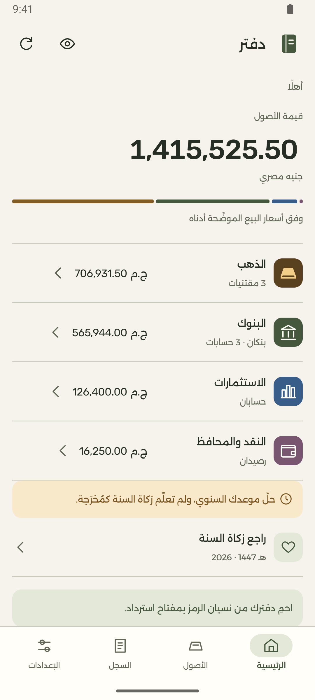
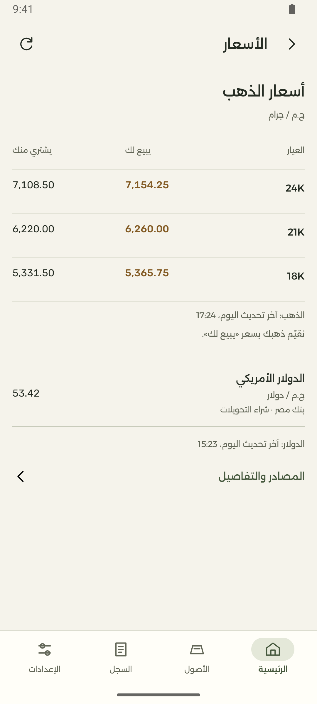
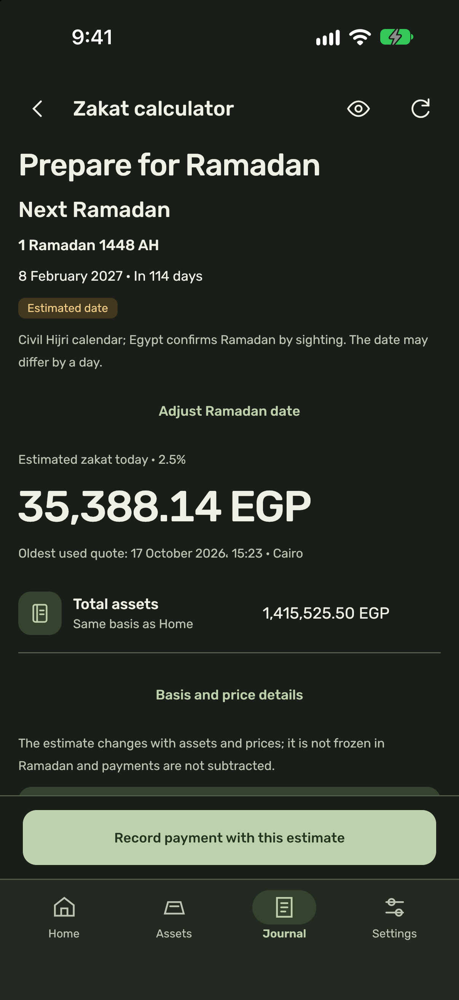
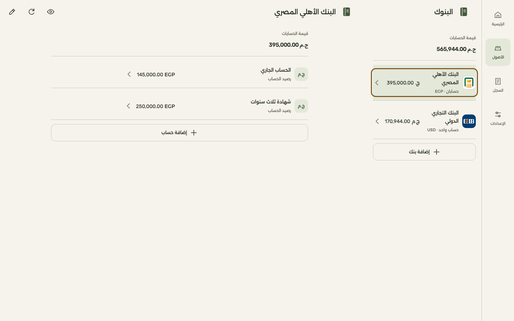
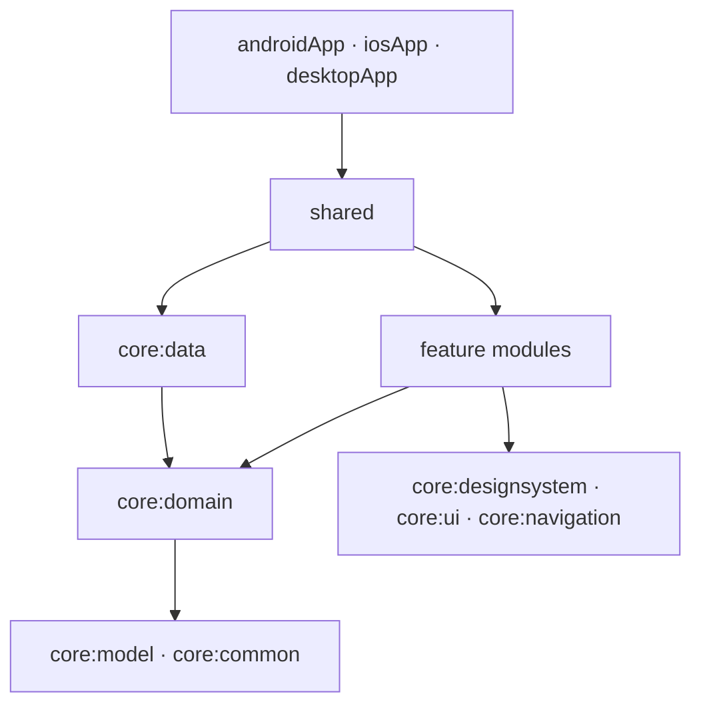

<p align="center">
  <picture>
    <source media="(prefers-color-scheme: dark)" srcset="docs/design/brand/daftar-icon-dark.svg">
    
  </picture>
</p>

<h1 align="center">Daftar · دفتر</h1>

<p align="center">
  <strong>A private notebook for your gold, accounts and cash.</strong>
</p>

<p align="center">
  For people tracking personal wealth in Egyptian pounds.<br>
  Financial records live in an encrypted vault on your device. No account required for local use.
</p>

<p align="center">
  <a href="https://github.com/mahmoudibrahimabdulfattah/Daftar/actions/workflows/ci.yml"></a>
  <a href="https://kotlinlang.org/multiplatform/"></a>
  <a href="https://github.com/JetBrains/compose-multiplatform"></a>
</p>

https://github.com/user-attachments/assets/e88e267e-59a0-49d1-bf31-2a17da892096

*Watch Daftar on Android, iPhone and macOS. 1080p, English captions and Arabic subtitles; no audio. The demo and screenshots use illustrative data.*

## Engineering highlights

- **One codebase:** [Kotlin and Compose Multiplatform](shared) share business logic and UI across Android, iOS and desktop.
- **Module boundaries:** [Feature modules](build-logic/convention/src/main/kotlin/KmpFeatureConventionPlugin.kt) depend on domain contracts, never on one another or `core:data`.
- **Encrypted vault:** [A random data key, PIN wrapping and persistent backoff](core/security/src/commonMain/kotlin/com/mk/daftar/core/security/DefaultVaultSecurity.kt) protect access to encrypted SQLite.
- **Hardware-backed keys:** [Release vaults require hardware protection](core/security); unsupported hardware is refused.
- **Capture protection:** [Android](androidApp/src/main/kotlin/com/mk/daftar/android/MainActivity.kt) and [desktop](desktopApp/src/jvmMain/kotlin/com/mk/daftar/desktop/WindowPrivacy.kt) window controls plus an [iOS shield](iosApp/iosApp/CaptureShield.swift); verification status is listed below.
- **Exact valuation:** [Base-10 decimals](core/model/src/commonMain/kotlin/com/mk/daftar/core/model/Decimal.kt) keep money, weights and prices precise, with explicit rounding.
- **Custom design system:** [Stateless Compose components](core/designsystem), Arabic RTL, English, bundled fonts and light/dark themes.
- **Tests and CI:** [Domain tests](core/domain/src/commonTest), [vault tests](core/security/src/commonTest) and [CI](.github/workflows/ci.yml) building and testing Android, desktop and iOS.

## What you can do

- **See what you own.** Record gold by karat and net weight, bank accounts and cash in EGP or USD, and investment accounts with an EGP value you update yourself.
- **Understand its value.** See a combined EGP valuation using gold and exchange-rate quotes, with sources and timestamps. Recorded USD balances retain their original currency.
- **Plan and record zakat.** View a 2.5% planning estimate of the tracked total, organize years with the civil Hijri calendar and record payments. Payments do not deduct from assets.
- **Keep private notes.** Journal entries stay separate from portfolio calculations. A visibility control masks financial values on screen.
- **Keep an encrypted copy.** Export and restore `.dftar` files. Optional Google cloud backups on Android and desktop provide three slots, each holding up to 768 KiB of ciphertext. Uploads are explicit; there is no automatic portfolio sync.

<details>
<summary>How valuation handles prices and missing data</summary>

Gold uses the goldsmith’s sell price for its karat. USD balances are converted to EGP for display.

Quotes include source and time information. Cached quotes remain available when refresh fails, and manual prices can fill gaps. A pinned manual override takes precedence until removed.

Missing prices produce an incomplete valuation with an available subtotal.

</details>

## A closer look

Arabic comes first, with full English support. Paper tones, olive accents and brass for gold give Daftar the feel of a notebook. Alexandria carries Arabic text; Rubik handles English and numeric runs.

| Your portfolio | Prices and sources | Zakat planning |
| :---: | :---: | :---: |
|  |  |  |
| Android · Arabic · Light | Android · Arabic · Light | iPhone · English · Dark |

**Room to work on desktop.** A navigation rail, keyboard input and side-by-side bank details make use of the wider screen.



*macOS · Arabic · Light. Offscreen rendering of the app’s client area.*

Explore the [design reference](docs/design/daftar.html), [desktop layout contract](docs/design/phase-28-desktop.md) and runnable [component catalog](core/designsystem/src/commonMain/kotlin/com/mk/daftar/core/designsystem/catalog/DesignCatalog.kt).

## Platform status

| Platform | Vault and unlock | Capture protection |
| --- | --- | --- |
| **Android 8.0+ · API 26+** | PIN and optional biometrics. Release requires a hardware-backed Keystore. | `FLAG_SECURE`; verified. |
| **iOS 16.0+ · iPhone and iPad** | PIN and optional Face ID or Touch ID, with Secure Enclave protection on devices. | Secure-canvas shield and capture-state fallback implemented. Real-iPhone verification pending. |
| **macOS** | PIN and optional Touch ID. Release requires a supported Secure Enclave. | `NSWindowSharingNone`; verified. |
| **Windows x64** | Development builds are PIN-only. Release vault access refuses because TPM protection is not implemented. | `WDA_EXCLUDEFROMCAPTURE` implemented; verification outstanding. |

Google cloud backups are available on configured Android and desktop builds. They are unavailable on iOS.

<details>
<summary>iOS capture protection and its verification limits</summary>

[`CaptureShield.swift`](iosApp/iosApp/CaptureShield.swift) hosts the app inside a secure text field’s canvas. If that canvas is unavailable, a cover hides content during detected recording or mirroring; this fallback cannot prevent still screenshots.

The implementation has been exercised only in the simulator so far. Simulator capture bypasses the shield, so it does not establish protection on a real iPhone.

</details>

## Architecture

Shared Compose screens sit above domain contracts. `shared` assembles features, repositories, security services and platform adapters through Koin.



The diagram shows the main dependency direction. Features do not depend on one another or on `core:data`.

<details>
<summary>Explore the modules</summary>

| Module | Responsibility |
| --- | --- |
| [`core/domain`](core/domain) | Pure valuation, quote selection, Hijri dates and zakat rules. Calculation functions receive time as input. |
| [`core/designsystem`](core/designsystem) | Custom theme, bundled fonts, stateless components and Compose Styles. |
| [`core/ui`](core/ui), [`core/navigation`](core/navigation) | Shared UI infrastructure and typed routes. |
| [`core/data`](core/data), [`core/database`](core/database), [`core/database-driver`](core/database-driver) | Repository implementations and Room over encrypted SQLite. Android and iOS use SQLCipher; desktop uses SQLite3 Multiple Ciphers in its SQLCipher v4 scheme through JNA. |
| [`core/security`](core/security) | PIN envelopes, persistent backoff, biometric key slots and platform protection. |
| [`core/backup`](core/backup) | Versioned, authenticated exports and restore contracts. |
| [`core/account`](core/account), [`core/cloud`](core/cloud) | Optional Google sign-in and encrypted backup storage. |
| [`shared`](shared) | App composition, navigation, the vault gate and lifecycle coordination. |
| [`build-logic`](build-logic) | Convention plugins for KMP libraries, Compose, features and the Android shell; shared compiler and formatting rules. |

</details>

## Security model

The PIN protects access to the database key. Optional biometrics provide another unlock path; Google sign-in never unlocks the vault.

<details>
<summary>Local encryption, key protection and automatic locking</summary>

The database uses a **random 256-bit data-encryption key**, or DEK. Argon2id derives a wrapping key from the PIN; XChaCha20-Poly1305 wraps the DEK with that key. The resulting envelope is then sealed by the platform protector before storage.

Changing the PIN rewraps the existing DEK without re-encrypting the database. Wrong-PIN attempts trigger persistent backoff. See [`DefaultVaultSecurity.kt`](core/security/src/commonMain/kotlin/com/mk/daftar/core/security/DefaultVaultSecurity.kt).

Release vaults require hardware protection. Android and desktop development builds may allow software keys with a visible warning; the iOS simulator has a separate test-only protector with no hardware guarantee.

The app covers private content during lifecycle transitions and locks on backgrounding or foreground inactivity. Desktop also locks on minimize, hide and supported system-session events.

Android system backup and device transfer are disabled. iOS vault files are excluded from backup, and Keychain records are device-only.

</details>

<details>
<summary>Encrypted backups and recovery limits</summary>

A `.dftar` export uses a separate password of at least 12 characters, Argon2id and XChaCha20-Poly1305. Each export receives fresh salts and nonces, and the header is authenticated.

The frozen version-one container remains readable and is written when no recovery key exists. With a recovery key enabled, version two encrypts the payload under a random backup key, wrapped for both the password and the recovery public key. See [`BackupFormat.kt`](core/backup/src/commonMain/kotlin/com/mk/daftar/core/backup/BackupFormat.kt).

An optional recovery key is shown once and is not stored by the app:

- Resetting a forgotten PIN requires the recovery key **and the original device**.
- The key opens backups created with that key enabled. It cannot open older password-only backups.
- Google sign-in provides access to cloud backup files; decrypting them still requires the backup password or the matching recovery key.
- Without a recovery key, a lost backup password or a forgotten PIN with no usable backup means the data cannot be recovered.

Cloud storage receives the encrypted backup file. Configuration and Firestore rules are documented in [`docs/firebase`](docs/firebase).

</details>

## Verification

[CI](.github/workflows/ci.yml) runs three jobs on every push and pull request: **Android** (Spotless, host tests, lint, and the debug and R8-minified release builds), **Desktop** (desktop tests and the app compile on macOS) and **iOS** (Kotlin tests on a simulator, the shared framework and the Xcode app build). Device tests and real-hardware checks stay part of the local verification required before a PR.

<details>
<summary>Build and test commands</summary>

Run before every PR:

```bash
./gradlew spotlessCheck testAndroidHostTest :androidApp:lintDebug :androidApp:assembleDebug :androidApp:assembleRelease
./gradlew desktopTest :desktopApp:compileKotlinJvm
./gradlew iosSimulatorArm64Test :shared:linkDebugFrameworkIosSimulatorArm64
xcodebuild -project iosApp/iosApp.xcodeproj -scheme iosApp \
  -destination 'platform=iOS Simulator,name=iPhone 18 Pro' -derivedDataPath build/xcode build
```

Security, Room and lifecycle changes also require Android device tests on an emulator or connected device:

```bash
./gradlew connectedAndroidDeviceTest :androidApp:connectedDebugAndroidTest
```

For UI changes, run the Android debug app and the iPhone 18 Pro simulator, then exercise the desktop app offscreen:

```bash
./gradlew :desktopApp:jvmTest
```

The desktop UI tests drive the real app with synthetic input and write screenshots to `desktopApp/build/screens`. iOS capture changes additionally require verification on a real iPhone.

</details>

## Run locally

Use **JDK 21**, **Android SDK platform 37** (`android-37.0`) and the included Gradle wrapper. iOS builds require macOS and Xcode; the configured simulator target is Apple Silicon. macOS native components also require Xcode’s command-line tools.

Run commands from the repository root. On Windows, use `gradlew.bat` in place of `./gradlew`.

<details>
<summary>Android, iOS and desktop setup</summary>

### Android

Open the project in Android Studio and run `androidApp` on an emulator or device. To build the debug APK:

```bash
./gradlew :androidApp:assembleDebug
```

The debug application ID is `com.mk.daftar.debug`.

### iOS

Open `iosApp/iosApp.xcodeproj` in Xcode, select the `iosApp` scheme and run on **iPhone 18 Pro**. To build from the command line:

```bash
./gradlew :shared:linkDebugFrameworkIosSimulatorArm64
xcodebuild -project iosApp/iosApp.xcodeproj -scheme iosApp \
  -destination 'platform=iOS Simulator,name=iPhone 18 Pro' -derivedDataPath build/xcode build
```

### Desktop

```bash
./gradlew :desktopApp:run
```

This starts a debug build with its own **Daftar Debug** data directory. Desktop builds remain debug unless built with `-Pdaftar.desktop.release=true`; release requires supported hardware protection.

</details>

<details>
<summary>Optional cloud backup and Android signing configuration</summary>

`androidApp/google-services.json` and `desktopApp/firebase-desktop.properties` are optional and git-ignored. Builds succeed without them, with cloud backups unavailable.

Use the [Firebase setup guide](docs/firebase/README.md) and [desktop configuration example](desktopApp/firebase-desktop.properties.example) when enabling cloud backups.

Android release signing is also optional for compilation. Copy [`keystore.properties.example`](keystore.properties.example) to the git-ignored `keystore.properties` and reference a keystore outside the repository.

Without signing configuration, `:androidApp:assembleRelease` produces an unsigned APK and never falls back to the debug key.

</details>

## Project status

Daftar is under active development. Windows hardware protection and real-iPhone capture verification remain open. The [roadmap](docs/roadmap.md) records project phases and acceptance criteria.

Issues and suggestions are welcome. See [AGENTS.md](AGENTS.md) for the engineering workflow and verification requirements.

Bundled font licenses and third-party notices are available in Settings → About.

Copyright © 2026 Mahmoud Ibrahim. **All rights reserved.** The source is published for viewing and evaluation only; see [LICENSE](LICENSE). Third-party fonts and libraries keep their own licenses.

If Daftar is useful to you, give the repository a star.

Mahmoud Ibrahim · [Website](https://mahmoudibrahimabdulfattah.github.io/) · [mahmoudibrahimabdulfattah@gmail.com](mailto:mahmoudibrahimabdulfattah@gmail.com) · [@mahmoudibrahimabdulfattah](https://github.com/mahmoudibrahimabdulfattah)
